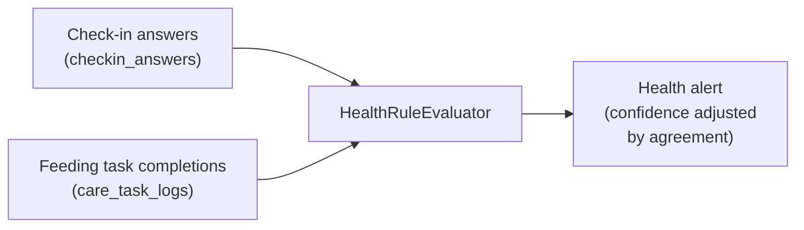

# Individual Development Report — Litterboxd

natashawa225

## Introduction

Litterboxd is an Android application for daily cat care that I worked on as part of a five-person team, contributing most of the onboarding flow, the Home dashboard, and the audit-and-fix pass that resolved a number of early correctness defects. The application combines a daily chip-based check-in, a rule-based health-alert engine, care-task reminders, and a diary that merges personal memories with care history read from the same database. This report sets aside what was built and asks a harder question: having inspected the finished application as a whole, where does it fall short, and what would I change given more time? The evaluation is based on reading the current source rather than the original feature list, and the proposals that follow are deliberately limited to three, each addressing a verifiable gap rather than a plausible-sounding addition.

## Critical Evaluation of the Current Application

Individually, most of Litterboxd's features work as intended: `DecisionTree` validates reachability and rejects cycles at construction, so a broken question tree can never ship; the health-rule engine distinguishes a sudden cluster of a symptom from a slow drift in a cat's own baseline rather than firing on any single bad day; and deleting a cat correctly cancels its scheduled reminders before cascading the deletion through the database. What is weaker is not any individual feature but the seams between them, and a small number of places where a feature quietly does less than its presence in the interface implies.

The clearest example of the first problem is the relationship between the daily check-in and the app's only proactive engagement mechanism, its reminder system. The reminders package reminds an owner about an unfinished care task, and separately about an unfinished "today's list," but never that the check-in itself is undone. This matters because the health-alert engine depends on days being logged consistently enough to form a baseline; a feature built around detecting gradual change has no mechanism protecting the regularity its own logic depends on. A related seam sits between the check-in and the care-tasks tab: both record essentially the same fact about whether a cat has eaten, one through an "appetite" chip and one through ticking off a feeding task, but these live in separate tables that are never read together. The health-rule evaluator only ever looks at check-in answers and weight history; it cannot notice that a day logged as "appetite: less" was also a day the feeding task was marked complete, or the reverse. Neither record is wrong on its own, but nothing treats them as describing the same event, so an owner inconsistent about which screen they use gets a correspondingly inconsistent picture of their cat's health.

A second category is features that are present but quietly incomplete. Check-in history is not kept indefinitely: every save trims that cat's check-ins older than ninety days, sensible for database size but meaning the diary's care-history timeline, and any feature wanting to look back further, has no data beyond that window. The "more info" reading accompanying a health alert depends on a live search against a third-party veterinary website with no fallback, so a layout change there degrades the feature silently rather than visibly. CSV export and the location permissions declared for a future "nearby vet" feature exist in the codebase but are reachable from no screen, which is honest about being unfinished but leaves dead code beside working features. Accessibility support is also thin and uneven: across the forty-four layout files, labelling such as `contentDescription` appears on roughly a quarter of them, concentrated unevenly rather than applied as standard practice, suggesting it was added reactively rather than designed in from the start.

## Proposed Future Development

The improvements I would prioritise follow from one observation: the application already collects more useful information than it uses, and the most valuable next step is connecting what exists rather than adding new screens.

The first is a context-aware check-in reminder. Every check-in row already stores a real timestamp of when it was logged, and the existing "today's list" reminder already demonstrates the mechanism needed, a single daily alarm read from stored preferences. Rather than a second fixed-time alarm, the reminder could learn each cat's typical logging time from stored history and fire shortly after that time on days when no check-in has yet been saved, falling back to a generic evening time only once no pattern can be established. This is context awareness precisely: the input is the owner's own interaction history, already in the database, and the behaviour that changes is only the timing of one existing notification, which keeps the change small and testable.

The second is to make the health-rule engine read across the check-in and care-tasks tables rather than treating them as unrelated. A rule that currently fires on logged appetite alone could require, or have its confidence reduced by, agreement with the feeding-task completion record for the same days; a persistent disagreement between the two could itself become a gentle prompt asking which record better reflects what happened.

This needs no new data source, only a wider query inside the evaluator and a small amount of matching logic, so it is feasible within the current architecture rather than requiring a rewrite.

The third addresses the ninety-day retention limit directly. Instead of deleting check-ins once they age out, the trim step could first collapse them into a small monthly summary, such as how many days were logged and how often each major chip was selected, and keep that summary indefinitely while discarding the detailed rows. This would let the diary, or a future year-in-review screen echoing the diary-and-memory idea the application is already built around, say something true about a cat's second half of last year without keeping a full behavioural log forever, also keeping retained data proportionate to what the feature needs.

## Conclusion

None of these three proposals introduces a feature the application lacks the pieces for. Each asks existing data, a logged timestamp, a completed task, a trimmed row, to be used once more before it is set aside, which is a smaller and more realistic step than adding new screens on top of features that do not yet talk to one another. If I continued developing Litterboxd, this is the direction I would take: not more functionality, but making the functionality already present behave as one coherent application rather than several adjacent ones.
