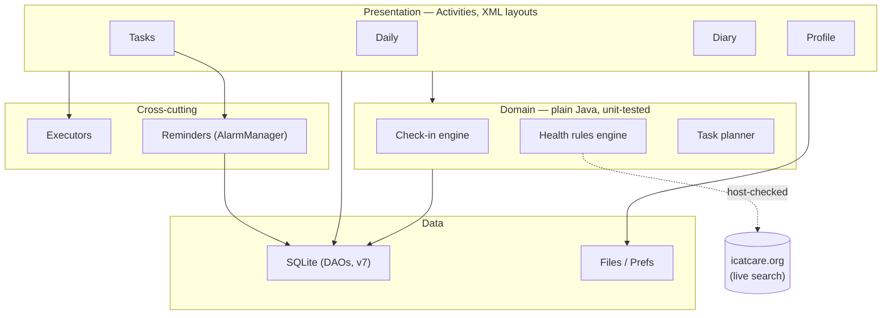
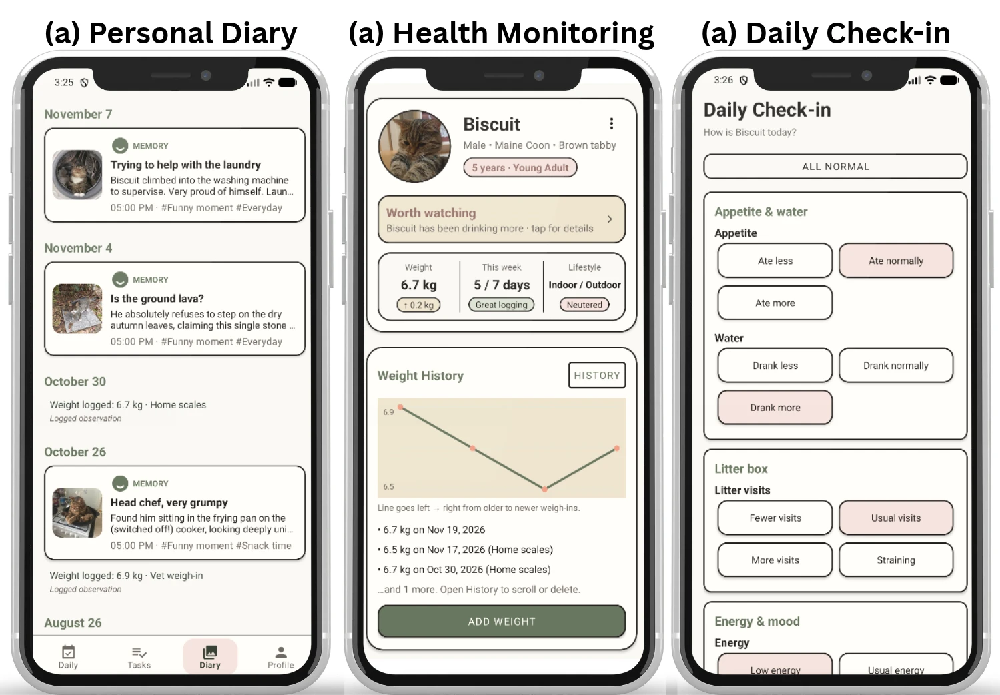
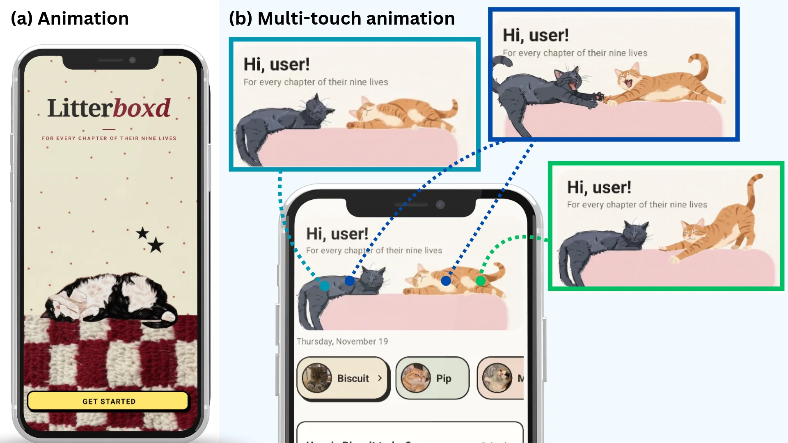

# LITTERBOXD

natashawa225, Raymond Harlie, Darren, [Member — to confirm], and farrell
Department of Computer Science and Software Engineering

## Abstract

Litterboxd is a native Android application for everyday cat care, built in Java on plain SQLiteOpenHelper and AlarmManager APIs without Room, Compose, or architecture-component libraries. It combines a Flo-style daily check-in with a decision-tree questionnaire, a rule-based health-alert engine that compares recent answers against a cat's own history, auto-generated and user-defined care tasks with scheduled reminders, a diary that merges owner-written memories with care history read from the same database, and a live "read more" search against a veterinary-information website for alerts that fire. The project was implemented by a five-person team on top of an onboarding and persistence skeleton, followed by a documented audit-and-fix phase that resolved twenty correctness defects before new features were added. This report describes the application's actual architecture, traces each feature to its implementing classes, reports the engineering decisions made during development, and evaluates the application against comparable products (Letterboxd and 11pets), including the privacy and ethical considerations raised by storing cat health data and querying a third-party website at runtime.

## 1. Introduction

Caring for a cat well means remembering several independent things at once: whether it has eaten, whether its litter-box behaviour has changed, when its next vaccination is due, and whether a symptom noticed last week is a one-off or a pattern. Most of this currently lives in an owner's memory or scattered notes. Generic habit trackers can log any one of these facts, but none connect a logged symptom to one answered three days earlier, and none distinguish "the cat skipped breakfast once" from "the cat has skipped a meal on four of the last seven days." Litterboxd was built to test whether a small set of plain Android components — a SQLite schema, a background executor, and a hand-written decision tree — could support that kind of longitudinal reasoning, while staying pleasant enough that an owner would open it every day. This also matches personal-informatics research: Li et al.'s stage-based model of tracking tools shows that logging is abandoned once it is not tightly coupled to a fast reflection step [1], and Rooksby et al. found that people weave several trackers together loosely rather than relying on one disciplined tool [2]. Litterboxd's chip-based check-in and its automatic alert banner follow directly from both findings — fast collection, and reflection shown by default rather than on request.

Two products in adjacent domains shaped the brief and are used as reference points. **Letterboxd** logs a film with the date it was watched and assembles those entries into a revisitable diary [8] — the model for Litterboxd's own Diary tab, though Letterboxd has no recurring daily check-in or reminders. **11pets** offers reminders for appointments, feeding, and vet-record sharing, with weight tracking [10]; it is the closest existing product to Litterboxd's goal, but its public description does not mention pattern detection across logged days or a personal diary distinct from medical records.

Litterboxd's contribution is joining three things that are normally separate products: a quick daily log, a rule engine that treats a sudden cluster of a symptom differently from a sustained shift in a cat's own baseline (which neither of the two above appear to do), and a diary that mixes the owner's own memories with care history read automatically from the same database. Concretely, this report documents: a decision-tree questionnaire engine with cycle and reachability validation, unit-tested independently of Android; a rule-based alert engine supporting both fixed-window and baseline-ratio matching with a weight-trend precondition; a care-task generator that keeps feeding reminders synchronised with a cat's schedule without duplicating history; and a fourteen-commit audit-and-remediation pass that is itself evidence of the team's engineering process.

## 2. App Design

Litterboxd is a single-module Gradle Android application written entirely in Java (`compileSdk/targetSdk 33`, `minSdk 26`), developed under a team-maintained technical reference (`docs/course_reference.md`) that limits the codebase to what the course had taught: XML-layout Activities (no Fragments or Compose), `SQLiteOpenHelper` for persistence (no Room), explicit `Intent` navigation, and `ExecutorService`/`Handler` for concurrency (no coroutines or LiveData/ViewModel). Because architecture-component libraries were off the table, the app uses a plain three-layer structure rather than MVVM (Figure 1): a **presentation layer** of Activities and XML layouts; a **domain layer** of plain-Java, unit-tested classes (the check-in decision tree, the health rule evaluator, and the feeding-task planner) with no Android imports; and a **data layer** of one `SQLiteOpenHelper` singleton (schema version 7) behind a DAO per table. `AppExecutors` (one thread pool, one main-thread `Handler`) and the `reminders` package (`AlarmManager` plus boot-persistent `BroadcastReceiver`s) sit alongside these layers as the cross-cutting pieces shown in Figure 1. The only deliberate exception to the technical reference is the Glide image-loading library, used to downscale and cache both local diary photographs and remote article thumbnails; this is discussed further in Section 3.

**Figure 1** summarises this architecture (Mermaid source, since the report was not rendered through a diagramming tool):

**Workflow.** A first launch routes `Splash → Welcome → OwnerName → AddEditCat → FeedingSchedule → Home`, inserting one cat and its feeding schedule; an interrupted onboarding resumes at the right step rather than restarting. From Home, a bottom navigation bar switches between four tabs — Daily, Tasks, Diary, and Profile. The Daily tab shows the selected cat, today's check-in status, today's care tasks, any live health alerts, and a Reading Corner carousel. Logging today opens a two-screen check-in (chip groups, then any unlocked follow-ups) — a design borrowed from outside the cat-care space: menstrual-cycle trackers such as Flo use the same tappable-chip, two-screen pattern to keep a daily log fast enough to sustain as a habit [9], and that interaction model is reused here for an unrelated domain (pet-care observations) rather than cited as a competing product; saving re-evaluates the health-rule engine and refreshes the alert banner and Reading Corner without a separate sync step.

**Components.** Representative classes, by feature: *Check-in* — `DecisionTree` (validates the question graph: unique ids, reachability, no cycles), `CheckInSession`, `HistoryTriggerEvaluator` (injects follow-ups from recent-day patterns). *Health* — `HealthRuleEvaluator` (fixed-window and baseline-ratio rule matching, optionally gated by a weight-trend precondition), `HealthArticleClient`/`HealthArticleFinder` (live, host-checked search against icatcare.org). *Care tasks* — `CareTaskSetup`/`FeedingTaskPlanner` (keep feeding reminders in sync with the schedule without duplicating completion history), `CareTasksActivity`. *Diary* — `DiaryActivity` (merges owner-written entries with weight/check-in history), `DiaryEntryEditActivity`. *Profile* — `CatProfileActivity`, `WeightChartView`, `ManageCatsActivity`. Resources include 43 layouts, JSON-driven content for the check-in tree, health rules, and article feed, and sample photos/videos for the welcome screen and the "pet the cat" interaction. Figure 2 shows the three screens discussed in most depth here and in Evaluation §3.3.

**Figure 2.** The three most-discussed screens. (a) Personal Diary: owner-written memories (card, photo, tags) interleaved with plain-text care-history lines read from `weight_logs`/`daily_checkins`. (b) Health Monitoring: a cat's profile, a "Worth watching" alert banner, and the weight-history chart and log behind it. (c) Daily Check-in: chip groups by category ("Appetite & water," "Litter box," "Energy & mood"), with an "All normal" shortcut for a routine day.

A small piece of UI polish worth noting briefly, since it is a design detail rather than a core requirement: the Welcome screen's looping cat video and the Daily tab's "pet the cat" interaction (Figure 3) both use genuine multi-touch handling rather than a single-touch listener. `PetTheCatView` tracks every finger by its own pointer id in a `SparseArray` (`getActionMasked()` + `getActionIndex()` + `getPointerId()`, handling `ACTION_POINTER_DOWN`/`ACTION_POINTER_UP` as well as `ACTION_DOWN`/`ACTION_UP`), so two fingers touching two different cats at once each get their own independent reaction rather than the view only noticing the most recent touch — a direct application of the multi-touch gesture-handling technique covered in the UI lecture material, shown in Figure 3(b1)–(b3): touching the left cat alone, both cats together, and the right cat alone.

**Figure 3.** (a) The Welcome screen's looping cat video wallpaper ("Get started"). (b) The "pet the cat" interaction, each touch tracked by its own pointer id: (b1) touching only the left cat moves just the grey cat; (b2) touching both cats at once is genuine multi-touch and moves both together; (b3) touching only the right cat moves just the orange cat.

**Group member contributions**, reconstructed from `git log` across all 74 commits on `main` (two Git-identity pairs are treated as one contributor each — see `REPORT_AUDIT.md` for the evidence, and confirm with the team):

| Member (Git identity) | Components developed |
|---|---|
| natashawa225 (51 commits, repository owner) | Onboarding flow, Home dashboard, bottom navigation, `CareTaskSetup`/`FeedingTaskPlanner` refactor, profile/settings screens, diary seed data and UI polish; ran the 20-item audit and fix pass |
| Raymond Harlie (git: h4rlieee/h4rlieeee) | Daily check-in feature end to end (`checkin` package, DB schema v4, `ui.checkin`); health reading suggestions and repeat-day alerts |
| Darren | Health article search and presentation (`HealthArticleClient`, `HealthArticleFinder`), health calendar/alerts/weight-history screens |
| [Member — to confirm] (git: k4chow/kachow) | Diary tab (entries, photos, milestones, care history); cat-avatar and Manage Cats fixes |
| farrell | Original daily/monthly care-tasks feature (superseded by the refactor above) |

**My contribution (natashawa225).** My work centred on initialising the project, building most of the UI, and resolving defects found during testing. *Java classes* — the initial project skeleton, including an early auth/session scaffold (`AuthRepository`, `PasswordHasher`, `LoginActivity`/`RegisterActivity`) later removed in favour of the current guest-style onboarding; the onboarding flow (`OwnerNameActivity`, `AddEditCatActivity`, `FeedingScheduleActivity`); the Home dashboard (`HomeActivity`, `CatCardRow`, `CatSwitcher`, `PetTheCatView`/`PetTheCatPlayer`); `SplashActivity` and `WelcomeActivity`; the profile and settings screens (`CatProfileActivity`, `EditProfileActivity`, `OwnerAvatars`, `SettingsActivity`); the original data layer (`LitterboxdDbHelper`, `LitterboxdContract`, `CatDao`, `WeightLogDao`, `FeedingScheduleDao`, `FileStorageHelper`); and, later, the `CareTaskSetup`/`FeedingTaskPlanner` refactor and `BottomNavHelper`. *Images* — the launcher icon across all five density buckets, the welcome-screen video wallpaper and the three "pet the cat" interaction clips, the four cat-avatar illustrations, and the seeded sample photos used to populate the Diary and Profile tabs for demonstration. *Other Android resources* — the custom display fonts, the core drawables (buttons, navigation icons, card backgrounds), roughly twenty of the app's layout files spanning onboarding, Home, Profile, and Diary, and the original database schema and manifest entries. *Project ideas* — the interactive welcome wallpaper and "pet the cat" touch interaction; replacing a fixed six-task seeder with care tasks derived from what the owner actually entered; and adopting an audit-then-fix process once the first feature pass was in. *Other contributions* — running the 20-item internal audit (`AUDIT_REPORT.md`) against the original onboarding/persistence code and implementing the fourteen priority fixes plus the follow-up clean-up (permission handling, rotation state, duplicate-cat prevention, thread-safety, photo-file clean-up); writing the manual test checklist and the team's technical reference document; and later UI polish (dashboard animation, the Reading Corner carousel, diary seed data).

## 3. Evaluation

**1. Major problems encountered.** The largest was correctness debt in the original onboarding and persistence code: an internal audit logged twenty defects, among them a notification permission that was never declared and so was silently denied, an "edit cat" screen that inserted a duplicate cat instead of updating it, and weight input that fell back to a default 4.0 kg whenever a comma decimal separator was typed. All twenty were fixed in single-purpose commits. A second problem was keeping auto-generated feeding reminders in sync with an edited feeding schedule without losing a task's completion history or duplicating it. A third was deciding how a health rule should treat a single bad day versus a real pattern, since cats can skip a meal for ordinary reasons.

**2. Possible solutions and final decisions.** For the audit findings, the alternative of patching issues inline with new feature work was rejected because it would make fixes impossible to review or revert individually; the team instead ran a prioritised, one-commit-per-fix remediation branch before resuming feature work. For feeding reminders, `FeedingTaskPlanner` matches an existing reminder to a schedule row by its stored time, so an edit updates rather than duplicates a task — simpler than re-deriving reminders from scratch on every edit, at the cost of a slightly less obvious matching rule. For health rules, the team rejected a single "any one bad day" rule in favour of two rule shapes: fixed-window signal counts for symptoms with an obvious threshold, and a baseline-ratio comparison against the cat's own longer history for subtler shifts — more complex to author in `health_rules.json`, but far less noisy. A related, smaller decision was adding the Glide library as the one documented exception to the course's plain-API constraint, to avoid hand-writing a second bitmap-caching pipeline for both local diary photos and remote article thumbnails.

**3. User interaction and comparison with similar apps.** The Daily tab is designed to be the one screen an owner needs most days, and the check-in is answered with chips rather than free text so a routine day takes only seconds to log; a chip's follow-up question only appears when that chip is actually selected, and reopening the check-in later the same day restores saved answers rather than starting over. Compared with the two cat/pet-care reference products, Litterboxd's Diary follows Letterboxd's dated-entry model [8] but interleaves memories with system-generated care history rather than logging one content type, and unlike 11pets, whose description centres on reminders and record-sharing without mentioning pattern detection [10], Litterboxd's alerts compare a recent window against the cat's own history rather than firing from a fixed schedule. The check-in's own chip-based logging pattern is not a comparison point against either product; as noted in Section 2, it is adapted from daily-logging apps in an unrelated domain. No usability study was run, so this is a description of the design intent rather than a measured outcome.

**4. Professional, legal, social, and ethical issues.** All cat data (profiles, weights, check-ins, diary entries, photos) stays in the app's own private SQLite database and internal storage; the app has no backend of its own, so nothing is transmitted to a server the team operates. The one exception is the live, read-only search against icatcare.org, which sends only the search terms derived from a fired alert, with a capped response size and a check that the response host is actually icatcare.org before any content is used — a safeguard against following a redirect to an unrelated site. `POST_NOTIFICATIONS` is requested once and its denial is handled; location permissions are declared for a future feature but never requested today. Health alerts are worded as "worth watching" or "see a vet" rather than as a diagnosis, though the UI carries no explicit non-diagnostic disclaimer yet, which the team should add before any wider release. Deleting a cat cascades to its weight logs and schedule through SQLite foreign keys, and a full reset clears all rows, photo files, and preferences.

## 4. Conclusion

Litterboxd combines a chip-based daily check-in, a rule-based health-alert engine that compares a cat's recent answers against its own history, synchronised feeding reminders, and a diary merging owner memories with automatic care history, built on a deliberately constrained Android toolchain. The clearest lesson from development was the cost of deferred correctness work: validation and thread-safety skipped in the first onboarding implementation required a full audit-and-fix pass touching nearly every early screen, while the check-in and health-rule logic, written test-first as plain Java, needed almost no later rework. Current limitations are a complete dependence on a third-party website for supplementary reading content, a one-to-two-week delay before any history-based alert can fire for a new cat, and no account, backup, or sharing mechanism beyond what Android itself provides. Future work would prioritise an explicit non-diagnostic disclaimer on the health-alerts screen and ratifying the Glide exception in the team's own technical reference.

## References

[1] I. Li, A. K. Dey, and J. Forlizzi, "A stage-based model of personal informatics systems," in *Proc. CHI '10*, Atlanta, GA, USA, 2010, pp. 557–566, doi: 10.1145/1753326.1753409.

[2] J. Rooksby, M. Rost, A. Morrison, and M. Chalmers, "Personal tracking as lived informatics," in *Proc. CHI '14*, Toronto, Canada, 2014, pp. 1163–1172, doi: 10.1145/2556288.2557039.

[3] Android Developers, "Save data using SQLite." [Online]. Available: https://developer.android.com/training/data-storage/sqlite

[4] Android Developers, "Schedule repeating alarms." [Online]. Available: https://developer.android.com/develop/background-work/services/alarms/schedule

[5] Android Developers, "Create a notification." [Online]. Available: https://developer.android.com/develop/ui/views/notifications/build-notification

[6] Android Developers, "Request runtime permissions." [Online]. Available: https://developer.android.com/training/permissions/requesting

[7] Android Developers, "Understand the Activity lifecycle." [Online]. Available: https://developer.android.com/guide/components/activities/activity-lifecycle

[8] Letterboxd Limited, "About Letterboxd — FAQ." [Online]. Available: https://letterboxd.com/about/faq/

[9] Flo Health Inc., "How do I use the app?" [Online]. Available: https://help.flo.health/hc/en-us/articles/360014347632-How-do-I-use-the-app

[10] 11pets, "11pets: Pet Care," App Store listing. [Online]. Available: https://apps.apple.com/us/app/11pets-pet-care/id1232470530

[11] Bumptech, "Glide: an image loading and caching library for Android," GitHub. [Online]. Available: https://github.com/bumptech/glide
